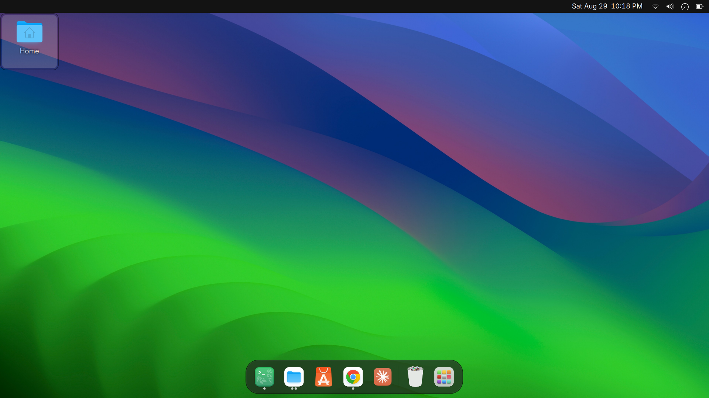

# macify

Make Ubuntu GNOME look like macOS: WhiteSur GTK/icon/cursor theme, a top bar
with an app menu and traffic-light window buttons, a themed autohide dock,
Inter font, Sonoma wallpaper, and a matching GDM login screen.

**This needs `sudo` and touches system files** (apt packages, the GDM login
theme). It is not rootless, and it's a different concern from a terminal/CLI
setup like [AI Workbench](https://github.com/abhibansal60/ai-workbench)
— that one installs its core tools into `~/.local` without sudo; this one can't,
because a login-screen theme lives under `/usr/share`.

Tested on Ubuntu 26.04, GNOME Shell 50, Wayland.



## What it sets up

| Component | What you get |
|---|---|
| GTK theme | [WhiteSur-Dark](https://github.com/vinceliuice/WhiteSur-gtk-theme) |
| Icons | [WhiteSur icon theme](https://github.com/vinceliuice/WhiteSur-icon-theme) |
| Cursor | [WhiteSur-cursors](https://github.com/vinceliuice/WhiteSur-cursors) |
| Shell chrome (top bar, overview) | WhiteSur-Dark via the `user-theme` extension |
| App menu + traffic-light buttons + weekday/date clock | [Unite](https://github.com/hardpixel/unite-shell) |
| Dock | Ubuntu's built-in `ubuntu-dock`, reconfigured: bottom, autohide, small icons |
| Font | [Inter](https://rsms.me/inter/) (UI/document text only — your terminal font is untouched) |
| Wallpaper | [WhiteSur-wallpapers](https://github.com/vinceliuice/WhiteSur-wallpapers) (Sonoma, dark + light) |
| Login screen (GDM) | Same WhiteSur theme, applied via `update-alternatives`-managed gresource swap |

## Install

```sh
git clone https://github.com/abhibansal60/macify.git
cd macify
./install.sh
```

Log out and back in when it finishes (GNOME only picks up freshly-installed
extensions on a session restart — not a bug, just how extension discovery
works), then enable the two shell extensions:

```sh
gnome-extensions enable user-theme@gnome-shell-extensions.gcampax.github.com
gnome-extensions enable unite@hardpixel.eu
```

## Reverting

```sh
macify ubuntu   # back to stock Ubuntu, in one command
macify mac      # re-apply the macOS theme
macify          # flip based on current state
```

The revert path uses `gsettings reset-recursively`, so it restores your
actual Ubuntu package defaults rather than guessed values — nothing drifts
between runs. The GDM step swaps between the stock file WhiteSur's own
installer already backs up (`.bak`) and a stashed copy of the macOS one
(`~/.local/share/macify/gdm-whitesur.gresource`), so neither direction needs
a rebuild.

The `sudo cp` for the GDM step only works from a real terminal (it needs an
interactive password prompt) — running `macify` through an automated
context will apply everything except the login screen and tell you so.

## Known gotchas

- **WhiteSur's GDM installer targets the wrong file on Ubuntu.** It assumes
  `/usr/share/gnome-shell/gnome-shell-theme.gresource`, but Ubuntu's GDM
  actually loads `/usr/share/gnome-shell/theme/Yaru/gnome-shell-theme.gresource`
  (selected via `update-alternatives`). Its own Yaru-detection logic handles
  this correctly internally — just don't go checking the top-level path for
  a timestamp change, it won't have one.
- **GNOME Shell only discovers extensions at session start.** Installing an
  extension's files while the shell is already running does nothing until
  you log out and back in — `gnome-extensions enable` will say the
  extension "does not exist" until then.
- **`gnome-screenshot` is broken on GNOME Shell 50.** The Ubuntu-repo version
  (41.0) calls the legacy `org.gnome.Shell.Screenshot` D-Bus interface
  directly instead of going through the `xdg-desktop-portal`, and GNOME 50
  now hard-denies that interface to any external caller —
  `AccessDenied: Screenshot is not allowed`, even run interactively from your
  own terminal. GNOME's own PrtScn overlay still works fine (it's internal to
  the shell, doesn't cross that D-Bus interface at all). For a scriptable
  fix, install `flameshot` instead (`sudo apt install flameshot`) — it goes
  through the portal properly, prompts once for a one-time "Allow Screenshot"
  permission, and after that `flameshot full -p out.png` just works,
  including from non-interactive contexts.
- **GTK4/libadwaita apps stay stock Adwaita.** Files, Settings, Text Editor,
  and anything else on GTK4 ignore GTK3 theme engines entirely — this is
  true on every distro, not a bug in this setup. No theme fixes it.

## Structure

```
install.sh    # full setup: apt deps, WhiteSur theme/icons/cursors, Unite,
              # dock config, font, wallpaper, GDM login theme
bin/macify    # the mac <-> Ubuntu toggle, installed to ~/.local/bin
```
